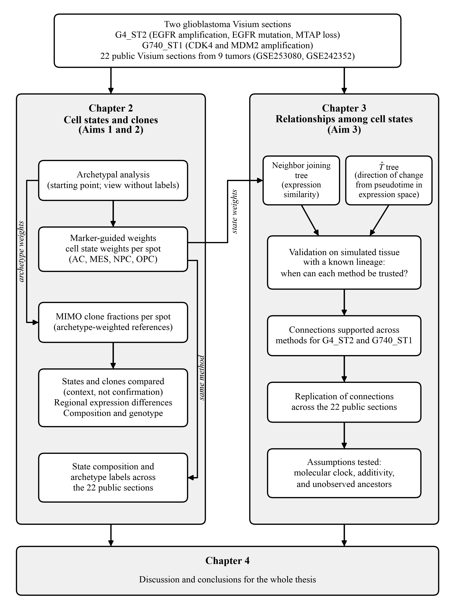
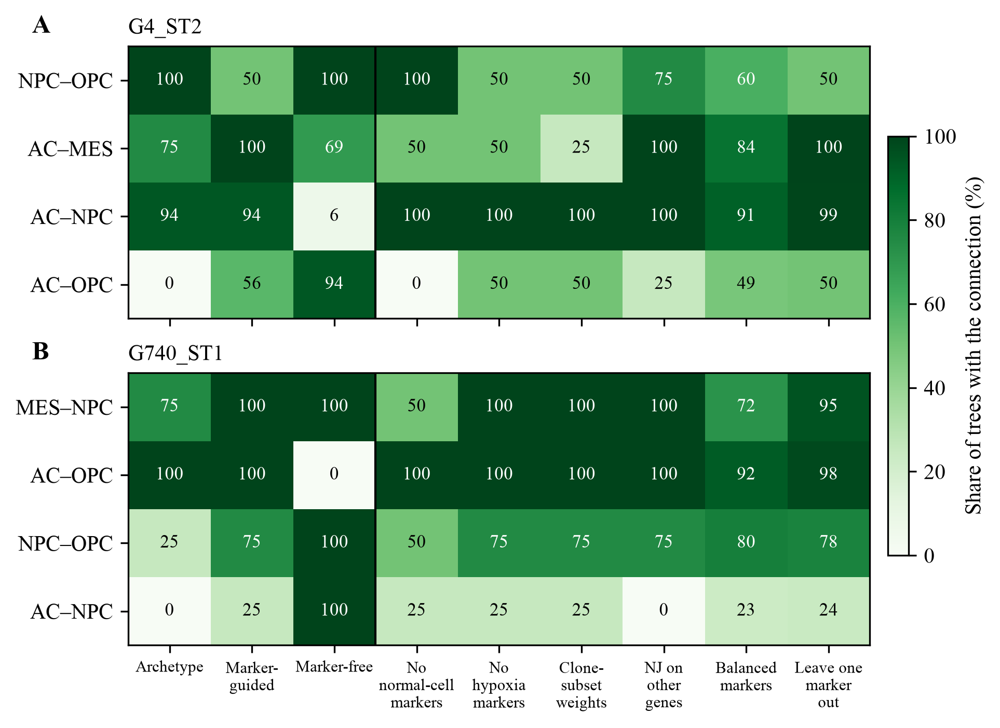

<div align="center">

# GBM Spatial State Connections

### Inferring relationships among glioblastoma cell states from spatial transcriptomics: from archetypal analysis to supported connections

Arun Sujatha Bharath Raj<br>
Schwartz Lab, Carnegie Mellon University<br>
Master's thesis, Quantitative Biology and Bioinformatics, 2026

[Key findings](#key-findings) &ensp;·&ensp;
[Data](#data) &ensp;·&ensp;
[Steps and scripts](#steps-and-scripts) &ensp;·&ensp;
[Citation](#citation)

[](https://github.com/Arun0364/gbm-spatial-state-connections/actions/workflows/tests.yml)




<sub>Overview of the thesis (Figure 1.1).</sub>

</div>

## Overview

Glioblastoma (GBM) contains four malignant cell states: astrocyte-like (AC), mesenchymal-like (MES), neural progenitor-like (NPC) and oligodendrocyte progenitor-like (OPC). Whether one state gives rise to the others, or cells switch between them, could affect how GBM is treated. Single-cell data lose where each cell was. Spatial transcriptomics keeps position, but each Visium spot mixes several cells.

This repository holds the code for a thesis that

1. estimates cell states and clones in two Visium sections, G4_ST2 and G740_ST1, without a matched single-cell reference,
2. builds trees of the states with two methods, neighbor joining (NJ) on expression similarity and a directed tree (T̂) from pseudotime transitions,
3. tests the tree methods in a spatial simulator with a known lineage, and
4. checks whether the connections found in the two sections recur in 22 public sections from nine tumors.

All evidence is computational. There is no laboratory work.

## Key findings

<p align="center">
  
</p>

<sub>Share of trees that contain each connection, across weight methods and robustness checks (Figure 3.4).</sub>

- **Marker-guided weights fix two problems of archetypal analysis.** Archetypal analysis placed the NPC-like archetype outside the spots and could give two archetypes the same label. Marker-guided weights resolved both and showed spatially clustered states.
- **Tree recovery in simulation.** With marker-guided weights, exact tree recovery by NJ rose from 36% to 97%. Connections that both methods agreed on were in the true tree 99.7% of the time.
- **Real tissue is harder.** In the public sections, the two methods disagreed on the whole tree in 77.3% of cases, against 7.9% in simulation.
- **Supported connections.** AC–NPC and AC–MES in G4_ST2, and AC–OPC and MES–NPC in G740_ST1. All four recurred in the public sections, but none was strong in more than four of the nine tumors, which suggests the connections may be tumor-specific.
- **Clones are not independent evidence.** MIMO clone estimates matched the states moderately, but in simulation they followed the input states in 76 of 80 clean tissues.

## Layout

```
Code/                      all scripts, flat, because they import each other by name
figures/algorithm_sources/ LaTeX sources for Algorithms 2.1, 2.2, 3.1 and 3.2
docs/assets/               figures shown in this README
tests/                     tests of the shared modules on synthetic data
renv.lock                  R environment (R 4.5.1)
requirements.txt           Python environment (Python 3.14)
requirements-test.txt      the smaller environment the tests need
Data/                      not tracked except Data/README.md, see Data
Results/                   not tracked, created by the scripts
```

## Data

All data are public on Gene Expression Omnibus and are not included here. [`Data/README.md`](Data/README.md) lists the folder layout the scripts expect.

| Folder under `Data/` | Source | Used in |
|---|---|---|
| `G4_ST2`, `G740_ST1` | GSE286413 (GSM8727283, GSM8727282), Pai et al., 2024 | Chapters 2 and 3 |
| `GSE253080` | GSE253080, 16 sections from GBM1 to GBM3, Lv et al., 2024 | Sections 2.7 and 3.6 |
| `GSE242352` | GSE242352 cohort B, six sections, Webb et al., 2025 | Sections 2.7 and 3.6 |

## External code (cited, not copied)

- **MIMO** (Lei et al., 2021) from the Schwartz lab, https://github.com/CMUSchwartzLab/FISH_deconvolution. Clone it inside this repository folder, alongside `Code/`. `Code/mimo_solve.py` imports `MIMO/MIMOsolver/MIMOsolver.py` from that clone. MIMO needs Gurobi (tested with Gurobi 13.0 on Python 3.13).
- **UNMIX** (Schwartz and Shackney, 2010) from the Schwartz lab. `Unmix_tumor_spatial.m` and `Unmix_replicate.m` call its MATLAB function `Unmix(M, k)`, which is not included. Place `Unmix.m` in `Code/`, since both `.m` files add `Code/` to the MATLAB path. `Code/unmix.py` is a Python port written for this thesis, used in the simulations (Section 3.4).
- **MosaicSim** (Srivatsa et al., 2023) from the Schwartz lab, https://github.com/CMUSchwartzLab/MosaicSim. `Code/spatial_coalescent_sim.py` draws the cell genealogy with msprime (Baumdicker et al., 2022; Kelleher et al., 2016) using the same call as MosaicSim. No MosaicSim code is included.
- **g:Profiler** web API (Kolberg et al., 2023) for the pathway tests in `chapter2_analysis.py`, so that step needs internet access.

## Paths

Every script finds the repository folder from its own location, so no paths need editing. Keep `Code/`, `Data/` and `Results/` side by side in the repository folder, as in [Layout](#layout).

- Python scripts use `Path(__file__).resolve().parents[1]` (or the `os.path` equivalent) as the repository folder.
- R scripts find it from the script path when run with `Rscript Code/<script>.R`, and use the working directory when sourced interactively, so start R in the repository folder.
- MATLAB scripts use `mfilename('fullpath')`.
- `run_replicate.sh` and `run_sim_clones.sh` expect the Python environment in `.venv/` in the repository folder. `run_sim_clones.sh` runs MIMO with `python3.13` by default. Set `MIMO_PYTHON` to use another Python with Gurobi installed.
- `mimo_solve.py` expects the FISH_deconvolution clone in the repository folder (see [External code](#external-code-cited-not-copied)).

The thesis was run from an earlier copy that used fixed paths. That version is tagged [`v1.0-thesis`](https://github.com/Arun0364/gbm-spatial-state-connections/tree/v1.0-thesis).

## Steps and scripts

Scripts are listed in the order they were run. Shared modules are listed last.

### 1. Preprocessing, states and tumor spots (Sections 2.1 and 2.2)

| Script | Output |
|---|---|
| `Preprocess_spatial.py` | `Results/Preprocess`, filtered sections |
| `Spatial_dimred.py` | `Results/DimRed`, normalized counts, PCA, UMAP |
| `Neftel_States_Visium_Pipeline.R` | `Results/neftel_outputs_curated`, Neftel state scores |
| `CellTypeAssignment_SingleR_Spatial.R` | `Results/CellTypeAssignment`, SingleR labels |
| `classify_tumor_normal.py` | `Results/TumorNormalClassification`, tumor and normal spots |

### 2. Archetype weights (Sections 2.2 and 2.3)

| Script | Output |
|---|---|
| `export_tumor_counts.py` | UNMIX input for tumor spots |
| `Unmix_tumor_spatial.m` | `Results/Unmix_tumor_k4_markers`, archetypes with K = 4 |
| `load_unmix_markers_to_h5ad.py`, `PostAAProcessing.py`, `derive_archetype_labels.py` | `Results/PostAA_tumor_unmix_k4_markers`, archetype weights and state labels |

### 3. Clones with MIMO (Section 2.4)

| Script | Output |
|---|---|
| `generate_pseudobulk_membership_from_csv.py` | pseudobulk groups of spots |
| `BuildMIMOCases.py` | MIMO input cases |
| MIMO (external) | clone fractions per pseudobulk |
| `aggregate_mimo_spot_fractions.py` | clone fractions per spot |
| `archetype_mimo_integration.py` | `Results/archetype_mimo_integration_k4_markers`, states merged with clones |

### 4. Chapter 2 results (Sections 2.2 to 2.6)

| Script | Thesis |
|---|---|
| `state_weights.py` | marker-guided weights (Section 2.2) |
| `chapter2_analysis.py` | state composition, clone matching, DE and pathways (Sections 2.3 to 2.6, Tables 2.4 and 2.5) |
| `spatial_morans_i.py` | Moran's I (Table 2.3) |
| `make_chapter2_figures.py` | Figure 2.4 |
| `make_thesis_figures.py` | Figures 2.6 and 2.7, and Figures 3.2, 3.3 and 3.5 |
| `pca_root_diagnosis.py` | archetype positions (Figure 2.1) |

### 5. Simulation (Sections 3.3 and 3.4)

| Script | Thesis |
|---|---|
| `spatial_coalescent_sim.py` | the spatial simulator |
| `sim_marker_purity.py` | spot purity of the simulator |
| `sim_aa_run.py`, `sim_aa_summary.py` | archetype baseline, 16,000 tissues, Table 3.2. Run with 1,000 seeds, output `Results/sim_aa/aa_results_1000.csv` |
| `sim_marker_guided.py` | marker-guided weights, 4,800 tissues, precision (Table 3.2) |
| `sim_ablation.py` | ablation of the weight steps |
| `sim_marker_robust.py`, `sim_marker_robust_scaled.py` | robustness to wrong markers |
| `run_sim_clones.sh`, `sim_clone_cases.py`, `sim_clone_eval.py`, `mimo_solve.py` | MIMO on simulated clones |
| `make_fig3_1_weight_estimates.py` | Figure 3.1 |

### 6. Trees in the two sections (Section 3.5)

| Script | Thesis |
|---|---|
| `state_trees.py` | NJ and T̂ trees with bootstrap support (Table 3.3) |
| `spatial_that.py` | spatial T̂ |
| `ape_check.py`, `ape_check.R` | NJ check against ape |
| `real_markerfree_trees.py`, `real_marker_sensitivity.py`, `real_root_check.py` | marker-free trees, marker sensitivity, root check |
| `make_fig3_4_supported_connections.py` | Figure 3.4 |

### 7. Replication in 22 public sections (Sections 2.7 and 3.6)

```
zsh Code/run_replicate.sh pre
matlab -batch "run('Code/Unmix_replicate.m')"
zsh Code/run_replicate.sh analyze
```

`run_replicate.sh` calls `replicate_prepare.py`, `replicate_annotate.R`, `replicate_classify_export.py` and `replicate_analyze.py`. Then `replicate_summary.py` and `replicate_leaveout.py` give the summary tables (Table 3.4) and the leave-one-out check, and `make_fig3_6_replication.py` draws Figure 3.6.

### 8. Tree assumptions (Section 3.7)

| Script | Thesis |
|---|---|
| `tree_assumptions.py` | three-point and four-point tests (Table 3.5), hidden-ancestor score (Section 3.7), and six-state trees (Section 3.5) |

### Shared modules

`marker_weights.py`, `unmix.py`, `tree_compare.py`, `real_marker_trees.py`, `three_point_test.py`, `ancestral_nodes.py`, `sim_grid_run.py`, `sim_improve_run.py`, `sim_improve2.py`, `sim_refine.py`, `make_chapter3_figures.py`, `make_chapter2_de_figures.py`, `plot_real_trees.py`.

## Known gaps

- Four Chapter 2 figures (Figures 2.2, 2.3, 2.5 and 2.8) were drawn from the outputs of `chapter2_analysis.py` and `replicate_summary.py`, without a saved figure script.
- The clone fractions used in Section 2.4 were made with an earlier version of `aggregate_mimo_spot_fractions.py` that wrote to `Results/PI_MIMO_VISUALS_tumor_unmix_k4_markers`. The version here writes to a later folder. The method is the same.

## Environment

```
python -m venv .venv
.venv/bin/pip install -r requirements.txt
Rscript -e 'install.packages("renv"); renv::restore()'
```

MATLAB is needed for the two `.m` files.

## Tests

The shared modules are tested on synthetic data with a known answer, so the tests need no data and run in about a second. They run on every push through GitHub Actions.

```
pip install -r requirements-test.txt
pytest -q
```

| Test file | What it checks |
|---|---|
| `tests/test_tree_compare.py` | Neighbor joining recovers additive trees and their distances exactly; the state graph recovers all 16 four-state trees; the optimal arborescence matches the best-ranked tree; the module's own self-test |
| `tests/test_unmix.py` | On mixtures of three known archetypes, the Python UNMIX port gives fractions that sum to one and track the true mixture (r > 0.95), and archetypes within 20% of the truth |
| `tests/test_marker_weights.py` | Marker-guided weights are proportions and track the true state weights (r > 0.9) |
| `tests/test_tree_assumptions.py` | The three-point and four-point tests are zero on ultrametric and additive distances and positive on a non-additive one |

## Citation

If you use this code, please cite the thesis:

> Sujatha Bharath Raj, A. (2026). *Inferring relationships among glioblastoma cell states from spatial transcriptomics: From archetypal analysis to supported connections* [Master's thesis, Carnegie Mellon University].

GitHub also shows a "Cite this repository" link from [`CITATION.cff`](CITATION.cff).

## License

The code in this repository is released under the [MIT License](LICENSE). External tools (MIMO, UNMIX, MosaicSim) are not included and keep their own licenses. The data are from GEO and keep the terms of their original publications.
